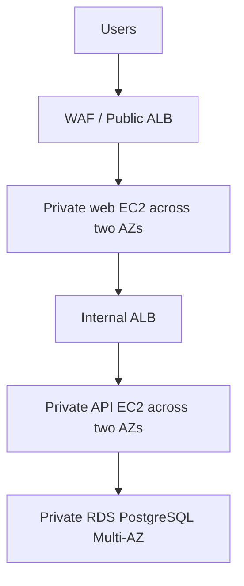

# Secure Cloud Migration Capstone
Three-tier order management | AWS Mumbai | B.Tech CSE (Cyber Security), semester 5

This repository accompanies [the capstone report](docs/Cloud%20Capstone.pdf). It contains a local demonstration and proposed AWS infrastructure. No AWS deployment or production approval is claimed. Screenshots are illustrative.

## Local demo
Install Docker with Compose. Copy `.env.example` to `.env`, replace the password and demo token with strong random values, then run `docker compose up --build`. Open http://localhost:8080 and enter the demo token. Run `docker compose down -v` to delete demo data. This is a local-only demonstration, not production authentication or TLS.

## AWS deployment
See [deployment guide](docs/deployment-guide.md). Terraform provisions the network foundation, security groups and private encrypted RDS; remaining services are documented manual steps. Review costs before applying. Do not publish credentials or Terraform state.

## Assessment coverage
- Cloud models and architecture: report sections 1–2
- Deployment: infrastructure and application directories
- Security: security directory
- Risk and NIST CSF: security directory
- Monitoring, cost and approval: monitoring and docs directories

Actual cloud tests remain pending. See [go-live checklist](docs/go-live-checklist.md).
